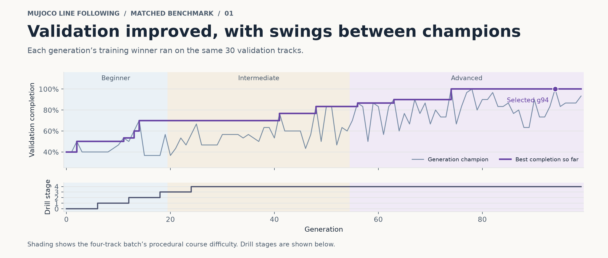
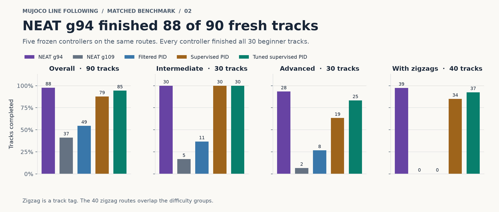
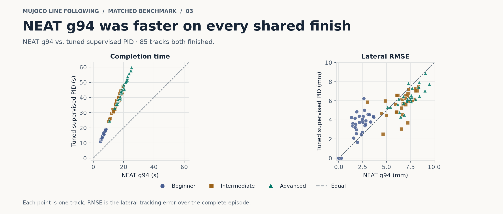
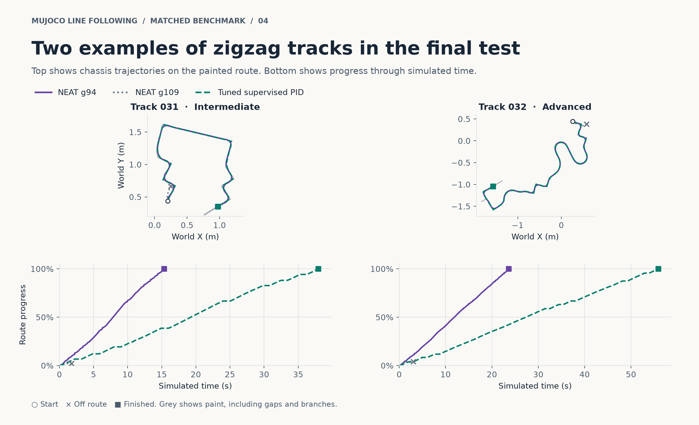

# NEAT corner training results

The selected **generation 94** controller finished **88 of 90 fresh test tracks (97.8%)**. On those same tracks, tuned supervised PID finished **85/90 (94.4%)** and the previous NEAT model, g109, finished **37/90 (41.1%)**. The new model finished 39 of 40 tracks tagged with zigzags, compared with 37 for tuned PID and zero for g109.

## Training and model selection

The run completed 100 generations with a nominal population of 96 and one evolution seed. The logs contain 38,416 training episodes across 400 unique tracks, plus 3,000 evaluations of generation champions on the fixed validation set. The curriculum reached its final drill stage at generation 24 after meeting the earlier stages' competence thresholds. The procedural course switched to advanced difficulty at generation 55.

Validation completion rose from 12/30 at generation 0 to 21/30 at generation 14 and 25/30 at generation 48. Generations 74, 78, and 94 each finished 30/30. Generation 94 had the highest validation fitness among them and was frozen before final assessment. It had two hidden nodes and 31 enabled connections. Across the last ten generations, the median champion finished 26/30 and the final champion finished 28/30. The gains are clearest in the best checkpoints, with variation between generation champions.

## Final test

| Controller | Beginner | Intermediate | Advanced | Total | Zigzag tracks | Mean lateral RMSE | Mean lateral MAE |
| --- | ---: | ---: | ---: | ---: | ---: | ---: | ---: |
| **NEAT g94** | 30/30 | 30/30 | **28/30** | **88/90** | **39/40** | 6.88 mm | 4.69 mm |
| NEAT g109 | 30/30 | 5/30 | 2/30 | 37/90 | 0/40 | 26.19 mm | 17.71 mm |
| Filtered PID | 30/30 | 11/30 | 8/30 | 49/90 | 0/40 | 34.62 mm | 21.66 mm |
| Supervised PID | 30/30 | 30/30 | 19/30 | 79/90 | 34/40 | 8.40 mm | 5.63 mm |
| Tuned supervised PID | 30/30 | 30/30 | 25/30 | 85/90 | 37/40 | **6.52 mm** | **4.44 mm** |

Each tracking error is an equal-weight average of the per-episode errors, including failed episodes over their observed duration. The five controllers ran with matched CPU MuJoCo settings on the same 90 geometry hashes. The test logs contain all 450 expected episodes with zero technical errors. The comparison uses this fresh cohort throughout.

## Paired speed and tracking accuracy

| Comparator | Both finished | Only g94 finished | Only comparator finished | Neither finished | Mean g94 time | Mean comparator time |
| --- | ---: | ---: | ---: | ---: | ---: | ---: |
| NEAT g109 | 37 | 51 | 0 | 2 | 7.97 s | 11.60 s |
| Filtered PID | 49 | 39 | 0 | 2 | 9.55 s | 11.88 s |
| Supervised PID | 79 | 9 | 0 | 2 | 13.07 s | 30.52 s |
| Tuned supervised PID | 85 | 3 | 0 | 2 | 13.33 s | 31.36 s |

Each pair of time means uses only the tracks both controllers finished. Against tuned PID, g94 was faster on all 85 shared finishes and used **57.5% less time on average**. Tuned PID tracked slightly closer on that same subset, with a mean lateral RMSE of 5.13 mm versus 5.27 mm for g94.

## Example runs and remaining failures

On the illustrated zigzag tracks, g94 and tuned PID both finished while g109 went off route. The new controller's two test failures were advanced tracks 041 and 062, ending at approximately 37% and 24% route progress. Both tracks also defeated all four comparators. Both contain gaps and crossings, and only track 041 carries the zigzag tag. Those labels describe the courses. The saved telemetry covers other tracks, so the specific failure mechanisms remain undetermined.

## Implications for the next experiment

This is one trained seed. It shows a substantial difference between the two frozen NEAT controllers on matched tracks. The comparison bundles changes in sensor history, output mapping, curriculum, and evolutionary settings, so it cannot isolate the effect of population size or any single parameter in `neat-corner.txt`. Repeat the current configuration across independent seeds to estimate its variability. For an activation comparison, hold the two outputs at tanh, vary only the hidden activation, and match seeds and episode budgets across conditions.

The [test summary CSV](artifacts/neat-corner-results/test-summary.csv) contains the per-controller and per-subset metrics. The [paired summary CSV](artifacts/neat-corner-results/paired-summary.csv) contains matched outcomes, times, and errors. Source records are in the [run protocol](../runs/neat-corner-100-20261104/protocol.json), [training log](../runs/neat-corner-100-20261104/training/generations.csv), and [final test episodes](../runs/neat-corner-100-20261104/assessment/test-episodes.csv). Each figure is available as PNG and SVG. Regenerate them from the project root with `python research/plot_corner_results.py`.
