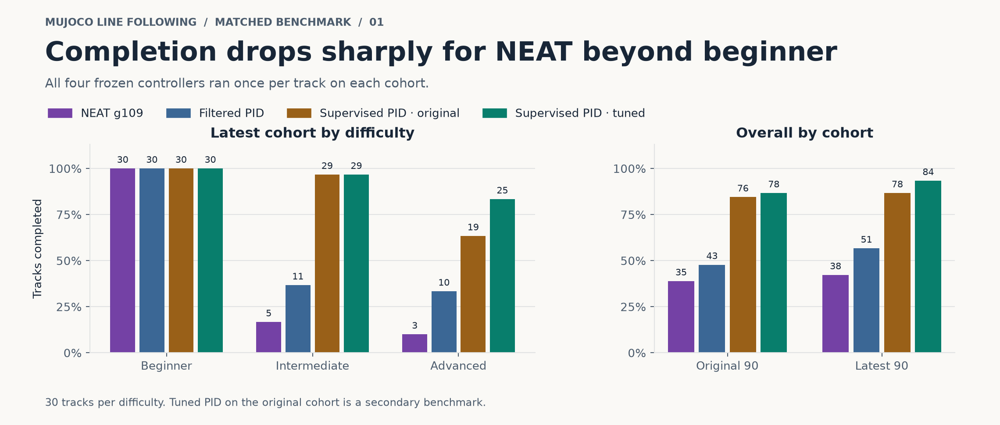
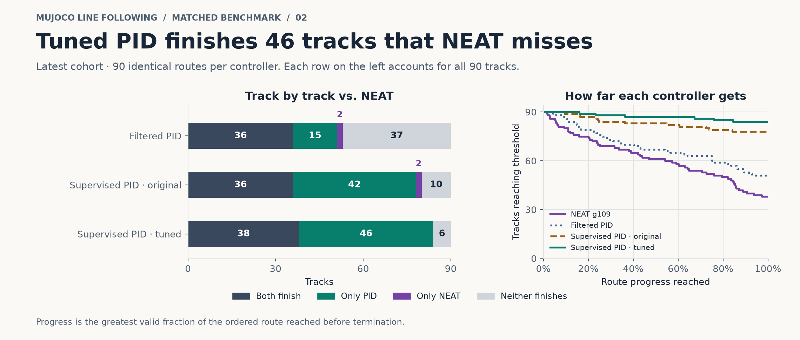
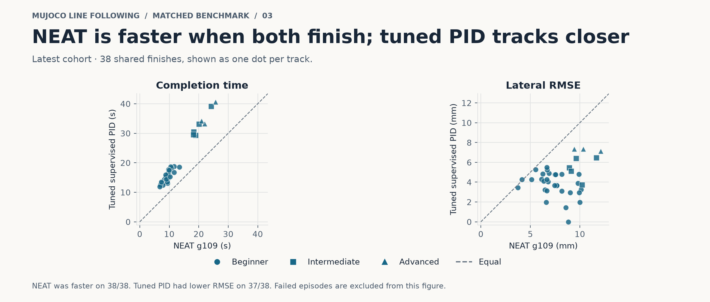
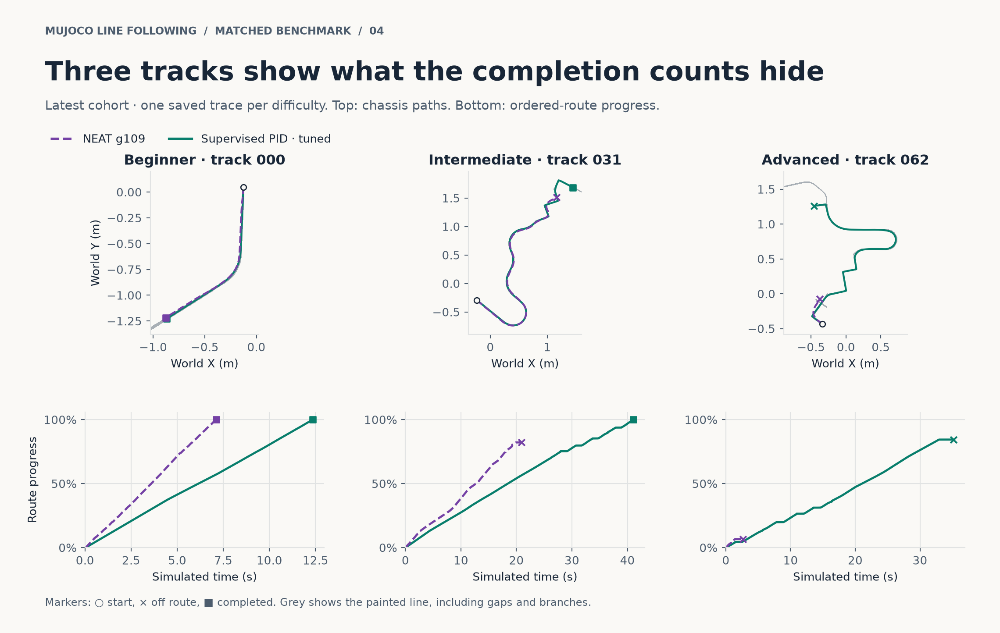

# NEAT vs. PID on the same tracks

**4 November 2026 · MuJoCo simulation.** On the latest 90 tracks, the validation-selected NEAT g109 finished **38/90 (42.2%)** and the tuned PID with corner supervision finished **84/90 (93.3%)**. Tuned PID finished every track NEAT did, plus **46 more**. On the 38 tracks both finished, NEAT was faster every time; tuned PID had lower lateral RMSE on 37.

## Completion by difficulty

| Frozen controller | Beginner | Intermediate | Advanced | Latest total | Original total |
| --- | ---: | ---: | ---: | ---: | ---: |
| NEAT g109 | 30/30 | 5/30 | 3/30 | 38/90 | 35/90 |
| Filtered PID | 30/30 | 11/30 | 10/30 | 51/90 | 43/90 |
| Supervised PID, original gains | 30/30 | 29/30 | 19/30 | 78/90 | 76/90 |
| Supervised PID, tuned gains | 30/30 | 29/30 | 25/30 | 84/90 | 78/90 |

All difficulty columns use the latest cohort. The original 90 tracks are a separate benchmark with no geometry overlap; tuned PID's result there is a secondary assessment on an already evaluated cohort. NEAT g109 was unchanged between the two, so 35 vs. 38 finishes reflects a change of tracks.

## Progress and tracking error

| Frozen controller | Mean route progress | Lateral RMSE | Lateral MAE | Off-route failures |
| --- | ---: | ---: | ---: | ---: |
| NEAT g109 | 68.1% | 23.19 mm | 15.31 mm | 52 |
| Filtered PID | 76.0% | 30.11 mm | 17.71 mm | 39 |
| Supervised PID, original gains | 92.2% | 8.61 mm | 5.59 mm | 12 |
| Supervised PID, tuned gains | 96.7% | 6.65 mm | 4.48 mm | 6 |

Each track has equal weight in these latest-cohort averages. The two error columns average per-episode geometric errors over the observed part of each run, including failures. A controller that goes off route early can have a short error record, so read these metrics alongside completion and progress. On the 32 routes tagged with zigzags, tuned supervised PID finished 27, original supervised PID finished 24, and both NEAT and filtered PID finished zero. The route tag alone cannot identify where a controller failed.

## Speed on tracks both controllers finished

| PID comparator | Shared finishes | Mean NEAT time | Mean PID time |
| --- | ---: | ---: | ---: |
| Filtered PID | 36 | 11.26 s | 9.77 s |
| Supervised PID, original gains | 36 | 11.16 s | 18.02 s |
| Supervised PID, tuned gains | 38 | 11.70 s | 18.99 s |

Each row uses the exact same tracks for its two means; the subset can differ between rows. Against tuned supervised PID, NEAT averaged 7.29 s less per shared finish, while PID averaged 4.25 mm lateral RMSE versus NEAT's 7.96 mm. Thirty of these 38 tracks were beginner routes. Filtered PID was faster on average in its own head-to-head comparison with NEAT.

## Three examples

The plots use saved traces from benchmark slots 000, 031 and 062. Both controllers finished the beginner example. Tuned PID finished the intermediate example while NEAT went off route at 82.1% progress. On the advanced example both went off route: NEAT reached 6.6% and tuned PID reached 84.4%. These traces illustrate individual runs.

## Methods and files

- The analysis joins by geometry hash and verifies all 90 tracks per controller in each cohort, with matching difficulty, lengths and time limits. Both cohorts used CPU MuJoCo, the same robot and sensors, a 0.35 m/s wheel target limit, and the same episode rules.
- NEAT is the saved validation winner at generation 109 (one evolution seed). The tuned PID is the saved `gain-350` configuration. Its corner supervisor uses temporal state and can command pivots, while the saved feedforward NEAT policy cannot command reverse. The findings compare these particular controllers on generated tracks in simulation.
- A fixed-policy [NEAT replay](../runs/neat-frozen-comparison-replay-20261104/status.json) reproduced every saved episode metric on the latest 90. The comparison uses the original frozen PID assessments and does not count trace replays as additional episodes.
- [Summary CSV](artifacts/neat-pid-comparison/summary.csv) · [Paired track CSV](artifacts/neat-pid-comparison/paired-tracks.csv) · [Figure generator](plot_neat_pid_comparison.py). Each figure is also available as an SVG in the artifact folder.
- From the project root, regenerate with `.\.venv\Scripts\python.exe research/plot_neat_pid_comparison.py`. See the [original assessment](Comparative_Analysis.md) and [latest evaluation](NEAT_New_Cohort_Evaluation.md) for the full protocol and frozen artifacts.
