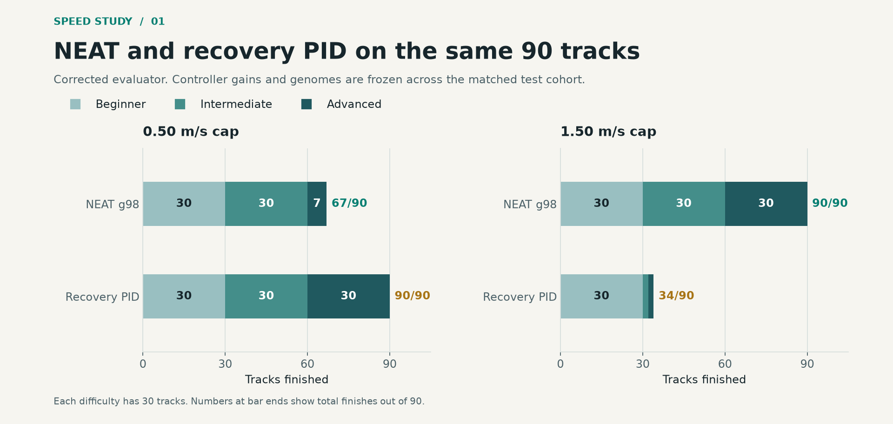
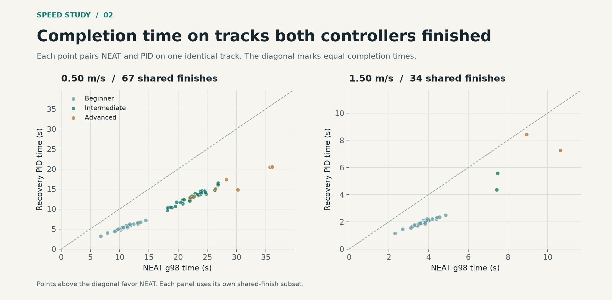
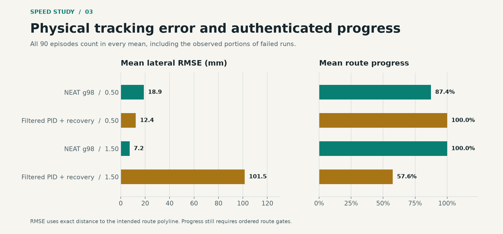
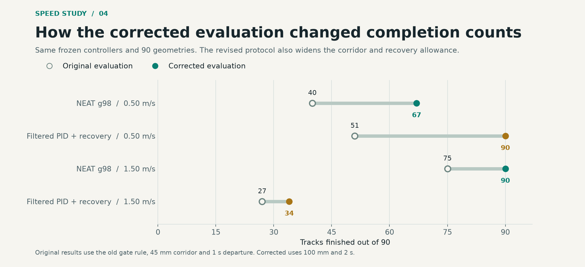

# NEAT speed results after the evaluator correction

Regenerated on 5 November 2026 from **360 matched test episodes** on the same 90 tracks. **Every NEAT result in this report uses the same frozen speed-trained g98 genome**, evaluated at either a 0.50 or 1.50 m/s wheel speed cap.

At the **0.50 m/s** cap, speed-trained NEAT **g98 finished 67/90** and recovery PID finished **90/90**. At **1.50 m/s**, the same NEAT **g98 finished 90/90** and the same recovery PID finished **34/90**.

The final speed-trained policy transfers imperfectly to the lower actuator cap. All 23 low-cap NEAT failures ended after five seconds without new ordered route progress. The recovery PID has the higher completion count at 0.50 m/s, while g98 has the higher completion count at 1.50 m/s.

## Matched test results

Each condition uses the same 30 beginner, 30 intermediate, and 30 advanced geometries. The NEAT genome and PID tuning are fixed across caps. All 360 episodes completed evaluation without a technical error.

| Controller | Cap (m/s) | Finished | Beginner | Intermediate | Advanced | Failure rate | RMSE (mm) | MAE (mm) | Mean progress |
| --- | ---: | ---: | ---: | ---: | ---: | ---: | ---: | ---: | ---: |
| NEAT g98 | 0.50 | 67/90 | 30/30 | 30/30 | 7/30 | 25.6% | 18.88 | 10.84 | 87.4% |
| Recovery PID | 0.50 | 90/90 | 30/30 | 30/30 | 30/30 | 0.0% | 12.37 | 10.26 | 100.0% |
| NEAT g98 | 1.50 | 90/90 | 30/30 | 30/30 | 30/30 | 0.0% | 7.24 | 4.80 | 100.0% |
| Recovery PID | 1.50 | 34/90 | 30/30 | 2/30 | 2/30 | 62.2% | 101.50 | 77.41 | 57.6% |



## Time and error on shared finishes

The time and error means below use only tracks both members of the pair finished. Each row reports its own denominator.

| Cap (m/s) | NEAT | Both finished | NEAT only | PID only | Neither | Mean time, NEAT / PID (s) | RMSE, NEAT / PID (mm) |
| --- | --- | ---: | ---: | ---: | ---: | ---: | ---: |
| 0.50 | g98 | 67 | 0 | 23 | 0 | 17.95 / 9.95 | 6.05 / 11.61 |
| 1.50 | g98 | 34 | 56 | 0 | 0 | 4.29 / 2.47 | 2.73 / 15.17 |

At 1.50 m/s, PID had a lower mean time on the 34 shared finishes, while g98 completed 56 additional tracks. The shared-finish table keeps that timing comparison on identical geometry.



Across the **67 tracks g98 finished at both caps**, it averaged **6.22 s at 1.50 m/s**, versus **17.95 s at 0.50 m/s**, using **65.3% less time**. Its corresponding mean geometric RMSE was **5.63 mm at 1.50 m/s** and **6.05 mm at 0.50 m/s**. This comparison holds the genome fixed and changes the speed cap.

The network uses the same sensor and history input schema at both caps. The changed cap rescales its motor commands. These outcomes measure how the speed-trained policy transfers when the actuator cap changes.

## Tracking error and failure reasons

Lateral RMSE and MAE measure the exact shortest distance from the chassis center to the intended route polyline. They average per-episode errors with equal weight for each track and include failed episodes through termination. The metric follows the intended centerline through gaps and excludes branch paint. Ordered progress remains a separate measure, so driving backward along the line can have low geometric error while earning no additional progress.



| Controller | Cap (m/s) | Off route | No new route progress | Other failures |
| --- | ---: | ---: | ---: | ---: |
| speed-g98 | 0.50 | 0 | 23 | 0 |
| Recovery PID | 0.50 | 0 | 0 | 0 |
| speed-g98 | 1.50 | 0 | 0 | 0 |
| Recovery PID | 1.50 | 44 | 12 | 0 |

## What changed in evaluation

The earlier evaluator could miss a corner gate while the robot was still tracking the line, leaving its local route cursor behind. Version **progress-1.2** makes gate tolerance cover corner cuts within the accepted corridor and resets the departure timer whenever a line sensor is active. This reassessment uses the same corrected protocol as the recreated videos, with a **100 mm corridor half-width**, **two seconds** of continuous departure with no sensor contact, and **five seconds** without new ordered progress for a stall. All controllers use the same rules.



The corridor and recovery allowance also changed from 45 mm and one second, so this figure measures the combined evaluator correction. The report's current error columns use geometric distance. The archived assessment's local gate-relative errors remain in the raw records for provenance.

## Frozen controllers and methodology

The recovery PID is the saved filtered baseline retained by the gains-only tuning experiment. Its P, I and D values are **0.7239850053**, **0.1681344890**, and **0.02158228171**, with base command **0.75**. Its derivative filter, bounded integral, error-dependent slowdown, 0.738 s last-command hold, and remembered-direction search all remain enabled. Corner supervision is disabled.

The original tuning robot used a **0.35 m/s** cap. The later search retained the original filtered gains. This study transfers that exact tuning to 0.50 and 1.50 m/s. The simulator's 600 Hz physics, 60 Hz control, robot geometry, and actuator limits match the speed experiment apart from the requested cap.

The g98 genome comes from the speed run that warm-started from g94 and evolved a nominal population of 100 for 100 generations, using four shared mixed-difficulty tracks per generation. The cap schedule rose through 0.50, 0.65, 0.80, 1.00, 1.25, and 1.50 m/s. Training and checkpoint selection used the original evaluator. g98 was selected by that run's validation rule before this reassessment. Both reported NEAT conditions load this exact selected artifact.

This is a retrospective comparison on a known test cohort from one evolution lineage. The reassessment retains the previously selected models. The [original protocol](../runs/neat-speed-100-20261104/protocol.json) and [frozen PID configuration](../runs/pid-gains-20261029/selected-pid_filtered.json) record their settings.

## Reproduce and present

- [Executed comparison notebook](NEAT_Speed_PID_Comparison.ipynb) embeds the corrected data, code, plots and tables.
- [Summary table](artifacts/neat-speed-results-corrected/test-summary.csv) and [paired results](artifacts/neat-speed-results-corrected/paired-summary.csv) contain the four reported conditions. The [raw episode archive](artifacts/neat-speed-results-corrected/test-episodes.csv) contains these 360 episodes plus 180 historical-reference evaluations of g94 and g00.
- [Evaluation freeze](artifacts/neat-speed-results-corrected/evaluation-freeze.json), [source snapshot](artifacts/neat-speed-results-corrected/source.zip), and [full telemetry](artifacts/neat-speed-results-corrected/telemetry/) preserve the inputs, gains, model hashes, and every replay.
- PNG and SVG versions of all four figures are in [the corrected figure folder](artifacts/neat-speed-results-corrected/).

From the repository root, regenerate the current report and notebook with the command below.

```powershell
./.venv/Scripts/python.exe research/write_corrected_speed_report.py
```
