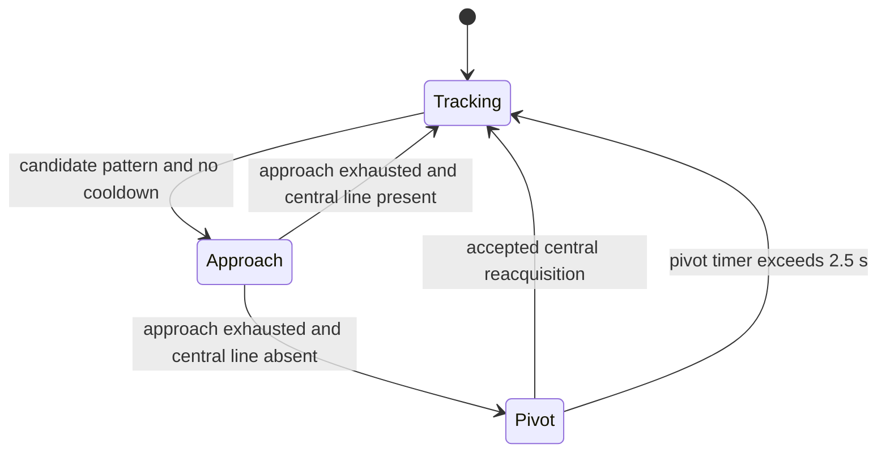

# PID controller methodology: filtered tracking and corner supervision

Implementation reference for the future research manuscript. Checked against the
saved code and configurations on **2 November 2026**. This documents the tested
implementation; it does not change a controller or begin the manuscript rewrite.

## 1. What the two names mean

| Research label | Implementation | Meaning |
|---|---|---|
| Filtered PID | `pid_filtered` | Sensor-centroid PID with a filtered derivative, bounded conditional integration, error-dependent forward command and explicit line-loss recovery. |
| PID with corner supervision | `pid_corner_supervised` | The same tracking law, with an additional rule-based finite-state supervisor for approaching a possible sharp corner, pivoting and reacquiring the line. |

“Filtered” refers specifically to the derivative term. The 15 binary sensor
readings are not converted into analog reflectance by this filter. Binary
transitions produce discrete changes in error; smoothing the derivative reduces
the immediate response to those changes. It does not guarantee stability or
eliminate quantization effects.

The supervised variant normally uses PID. During its approach and pivot
manoeuvres, explicit motor commands temporarily replace PID steering. Therefore
its performance must be attributed to **PID plus the supervisor**, not to PID
gains alone. The filtered variant also includes recovery and speed logic and
should not be described as an otherwise unmodified textbook PID.

The legacy `PIDController` in [controllers.py](../line_follower/controllers.py)
is a separate historical implementation. Its gains and error convention must
not be substituted into these research variants without an explicit derivation.

## 2. Information available to the controller

At each control step the controller receives the actual 15 binary reflectance
readings and the control timestep, normally 1/60 s. Sensor 0 is leftmost, sensor
7 is central and sensor 14 is rightmost in the robot's forward-facing frame.
Sensor intersections use the physical robot pose and shared floor reflectance
field; the viewer does not provide observations.

At construction the controller also receives the fixed robot configuration. It
knows nominal wheel spacing, maximum wheel-rim target speed, motor response time
and sensor mounting coordinates. These are mechanical priors, not new measured
observations. Its internal memory includes earlier errors, commands, a last-seen
direction, timers and estimated motion.

It does **not** receive true position, yaw, measured wheel speed, route geometry,
track identity, turn labels, gates, progress, difficulty or ground-truth lateral
error. Evaluation owns those quantities. In particular, knowing the sensor
mounting coordinates is different from knowing the robot's world position.

The tested robot uses 0.175 m wheel spacing, a 0.35 m/s wheel-rim target ceiling,
a 0.05 s motor command filter, 600 Hz physics and 60 Hz control. The semicircle
has a central longitudinal sensor offset of 0.09 m, radius 0.11 m and angular
span 1.7 rad; its outer sensors lie about 0.0526 m ahead of the axle. Complete
physical settings remain in each run's `run.json`.

## 3. Sensor error and sign convention

Let the active sensor set be

\[
A_k=\{i\in\{0,\ldots,14\}:s_{i,k}>0\}.
\]

When at least one sensor is active, the normalized tracking error is

\[
e_k=\frac{1}{7|A_k|}\sum_{i\in A_k}i-1.
\]

An exclusively active center sensor gives zero error; leftmost and rightmost
give -1 and +1. Negative error requests a left turn; positive error requests a
right turn. The simulator implements this sign through differential wheel
commands defined below.

This is a sensor-index centroid, not a calibrated lateral displacement in
meters. In particular, curved sensor placement and multiple active groups mean
it is not simply the physical distance of one detected line from the robot.
With no active sensors the code retains the previous normal-PID error as a
placeholder, then invokes recovery or an already active supervisor manoeuvre;
it does not interpret all-zero readings as zero tracking error.

## 4. Exact filtered PID update

For a normal tracking step with an active line, the raw and filtered derivatives
are

\[
d_k^{raw}=\frac{e_k-e_{previous}}{\Delta t},\qquad
\alpha_D=1-\exp(-\Delta t/\tau_D),
\]
\[
D_k=D_{k-1}+\alpha_D(d_k^{raw}-D_{k-1}).
\]

Here `previous_error` means the value retained by normal PID tracking; it is not
updated on every intervening recovery/supervisor call. The filter time constant
is `derivative_filter_s`. This is a first-order low-pass derivative filter, not
a moving average over the input sensor vector.

Define the forward command

\[
f_k=\max\left(f_{min},\frac{f_{base}}{1+\lambda|e_k|}\right).
\]

The provisional steering demand uses the old integral state:

\[
\widetilde u_k=K_Pe_k+K_II_{k-1}+K_DD_k.
\]

The implemented conditional integration is

\[
I_k=\begin{cases}
\operatorname{clip}(I_{k-1}+e_k\Delta t,-I_{max},I_{max}),&
|\widetilde u_k|<1-f_k\ \text{or}\ e_k\widetilde u_k<0,\\
I_{k-1},&\text{otherwise}.
\end{cases}
\]

This bounds accumulated error and inhibits integration when the requested turn
would exhaust forward-command headroom, while allowing an opposing error to
unwind the steering demand. It is the code's conditional-integration heuristic,
not a back-calculation anti-windup controller.

The final demand and independent wheel commands are

\[
u_k=K_Pe_k+K_II_k+K_DD_k,
\]
\[
a_{L,k}=\operatorname{clip}(f_k+u_k,-1,1),\qquad
a_{R,k}=\operatorname{clip}(f_k-u_k,-1,1).
\]

Commands are dimensionless wheel-speed targets before the unchanged actuator
filter, torque limits and contact dynamics. Negative wheel commands are allowed.
`minimum_command` bounds the forward component, not each individual wheel; it
does not forbid reversing one wheel or pivoting. The target ceiling is not a
constant measured chassis speed.

With normalized error and commands, K_P is dimensionless, K_I has units 1/s,
K_D has units s, D has units 1/s, and I has units s. The tested integral bound is
0.4 error-seconds. PID updates pause when recovery or supervision returns a
special motor command.

## 5. Line-loss recovery shared by both variants

Within ordinary tracking, an all-zero observation increments a loss timer. For
`loss_time <= loss_hold_s`, the controller repeats its last normal-PID wheel
command. This permits brief gaps to be crossed without an immediate search.
After that hold it commands a counter-rotation in the retained last-seen
direction, alternating the search direction every one second after the hold:

\[
a_L=d\,q(t)\,a_{search},\qquad a_R=-a_L,
\]
\[
q(t)=(-1)^{\lfloor t_{loss}-t_{hold}\rfloor}.
\]

This formula applies only after the hold interval. The direction d is updated
from the sign of a normal tracking error whose magnitude exceeds 0.02. At reset
d=+1 and the cached command is [0,0], so a robot initially seeing no line first
holds still and subsequently searches with a fixed default direction.

The integral and derivative are not advanced by this recovery branch. An active
line reaching ordinary tracking resets the loss timer. Approach/pivot calls
handled by the supervisor do not advance this timer: evaluator line-loss
intervals and the controller's recovery timer are consequently different things.
Also, “last valid command” specifically means the last **normal PID** command;
special approach/pivot commands do not overwrite that cache.

This is a bounded command-hold/search heuristic, not verified gap recognition or
a guarantee of recovery. A timeout or corridor departure can still terminate an
episode through the evaluator's independent rules.

## 6. Corner supervisor: states and entry conditions

The source has exactly three stored modes: `tracking`, `approach` and `pivot`.
Line-loss handling occurs inside `tracking`; it is not a fourth stored mode.

A corner candidate enters `approach` only if all the following hold:

| Condition | Exact implementation |
|---|---|
| Supervisor enabled | `corner_supervision == True` |
| Retriggering allowed | Cooldown has reached zero |
| Broad sensor response | At least three active sensors |
| Side-biased centroid | Absolute normalized error at least 0.18 |
| Central involvement | At least one active sensor in indices 6, 7, 8 |

“Side-biased” describes the centroid test. The code does not require every
active sensor to lie on the same side, and this pattern is not a perfect
classifier of a sharp corner. The direction is retained from the current/last
normal tracking cue. No hidden turn annotation or stored track sequence is used.

## 7. Approach and command-based motion estimates

Let x_i be the known longitudinal mounting coordinate of sensor i, relative to
the axle, and ell the configured `turn_lead_m`. At entry,

\[
r=\max(0,\operatorname{median}_{i\in A_k}(x_i)-\ell).
\]

The entry call emits equal wheel commands `approach_command`. On subsequent
approach calls, remaining distance decreases according to

\[
r\leftarrow r-\max(0,\widehat v_{previous})\Delta t.
\]

Every emitted command, including ordinary tracking and pivot commands, updates
the internal forward-speed estimate:

\[
\widehat v\leftarrow\widehat v+
(1-\exp(-\Delta t/\tau_m))
\left(V_{max}\frac{a_L+a_R}{2}-\widehat v\right).
\]

This is an estimate from prior requested motor commands and a nominal response
time. It is not an encoder, true displacement measurement or localization
system. Slip, traction and chassis acceleration can make it inaccurate.

While r>0, the controller continues equal approach commands. Once r<=0:

- If any central sensor (6–8) is active, the turn is cancelled and normal
  tracking resumes. This is intended to preserve a continuing main line at a
  branch; it does not prove that the geometry was a branch.
- Otherwise, the controller enters `pivot`, resetting its pivot timer and
  accumulated angular estimate.

## 8. Pivot, reacquisition, timeout and cooldown

The pivot requests opposite wheel commands,

\[
a_L=d\,a_{pivot},\qquad a_R=-d\,a_{pivot}.
\]

Its nominal angular magnitude accumulates once per supervisor call as

\[
\widehat\theta\leftarrow\widehat\theta+
\frac{2V_{max}a_{pivot}}{b}\Delta t,
\]

where b is wheel spacing. This rotational estimate uses nominal requested
wheel-rim speed; unlike the forward estimate, it does not apply a motor-lag
model. It is neither measured yaw nor proof of an actual turn angle.

Normal tracking resumes when all three reacquisition conditions hold:

- Estimated accumulated rotation is at least **0.65 rad** (about 37.2 degrees).
- At least one central sensor (6–8) is active.
- There are no more than three active sensors in total.

Thus the controller does not execute a prescribed 90-degree rotation. The angle
threshold inhibits premature acceptance, while the sensor pattern ends the turn.
The counter is updated before checking exits; its finite-timestep timing is an
implementation approximation, not a precise physical angular measurement.

Accepted reacquisition resets the integral and derivative to zero and sets
`previous_error` to the current error before resuming normal PID in the same
control call. If the pivot timer instead exceeds **2.5 s**, the code returns to
tracking without that explicit PID-state reset. Reacquisition is checked before
the timeout test. Timeout means an attempted fallback, not successful turning.

Cancelling the approach, successful reacquisition and pivot timeout each set a
**0.25 s cooldown**. This inhibits a new corner trigger; it does not stop normal
tracking or command the robot to wait motionless. Approach cancellation and
timeout retain the preceding PID state unless later ordinary updates change it.
Episode reset clears all controller state.

## 9. Parameter provenance and selected configurations

These values come from saved JSON configurations, not from class defaults:

| Parameter | Selected filtered PID | Initial selected supervised PID | Gains-only selected supervised PID |
|---|---:|---:|---:|
| K_P | 0.723985005322 | 1.386243657287 | 1.278230243668 |
| K_I (1/s) | 0.168134489040 | 0.114380625697 | 0.035193150760 |
| K_D (s) | 0.021582281714 | 0.084255258312 | 0.005676495055 |
| Derivative filter (s) | 0.019213046691 | 0.029968321538 | unchanged |
| Forward base command | 0.75 | 0.400487424737 | unchanged |
| Forward minimum command | 0.036898465603 | 0.162792167581 | unchanged |
| Error slowdown gain | 0.567546417775 | 2.418351697152 | unchanged |
| Integral bound (s) | 0.4 | 0.4 | unchanged |
| Loss hold (s) | 0.738230952360 | 0.725089170745 | unchanged |
| Search command | 0.507010558619 | 0.485149360666 | unchanged |
| Corner approach command | inactive | 0.366621099934 | unchanged |
| Corner lead (m) | inactive | 0.004156311172 | unchanged |
| Corner pivot command | inactive | 0.342400701375 | unchanged |

The table rounds display values; the JSON files retain full precision. Corner
entry thresholds, minimum rotation, timeout and cooldown are programmed constants,
not parameters optimized in the gains-only experiment. The initial bounded
study optimized other exposed control parameters as well as gains. The follow-up
changed only K_P, K_I and K_D within each previously selected variant.

Authoritative files:

- [Initial filtered configuration](../runs/pid-research-20261029/selected-pid_filtered.json).
- [Initial supervised configuration](../runs/pid-research-20261029/selected-pid_corner_supervised.json).
- [Follow-up supervised configuration](../runs/pid-gains-20261029/selected-pid_corner_supervised.json).
- [Follow-up selection freeze](../runs/pid-gains-20261029/selection-freeze.json).
- [ResearchPIDConfig and ResearchPIDController](../line_follower/pid.py): parameters,
  reset, `_command`, `_supervised_action` and `act` are the implementation sources.
- [Episode loop](../line_follower/episodes.py) and
  [evaluation/telemetry exporter](../line_follower/pid_experiments.py) own metrics
  and call controller reset separately for each episode.

Verified `line_follower/pid.py` SHA256:
`51f45b9adb64a46d63da7d937aab7933b8e607bc28b5e3c7e6719c12e5c4204e`.
Both PID studies recorded package source SHA256
`78acab6866de9a70228f5c8e6b3e84a74592c0d00290927a0c87ccdc5909da8d`.
Run-local source ZIPs and freeze files preserve the evaluated versions. If the
implementation changes later, this note describes those frozen versions and
must be revised explicitly before describing the new code.

### Reading saved telemetry correctly

The PID exporter adds `pid_error`, `pid_integral`, `pid_derivative`, `pid_turn`
and `pid_mode` to the shared episode telemetry. Important interpretation rules:

- `observation_time_s` and `sensor0` through `sensor14` describe the decision
  input. `next_sensor0` through `next_sensor14` describe sensing after the action;
  the shared physical state is also recorded after stepping.
- `pid_error` is the normalized sensor-index error, not the geometric lateral
  error in meters. During all-zero sensing it retains the previous normal error.
- `pid_turn` is reset to zero before each decision and assigned on normal PID
  computation. A logged zero during a supervised pivot does not mean zero motor
  turn: inspect `action_L`, `action_R` and `pid_mode` together.
- `pid_mode == tracking` also covers ordinary loss hold/search. It does not
  establish that a line was visible or that PID generated that step's commands.
- Internal integral/derivative values can remain constant while normal PID is
  bypassed. They must not be interpreted as continuously updated error signals.
- The five PID columns do not directly export the approach-distance, speed or
  angular estimates or cooldown timer. Those quantities are implementation
  state, not measured pose; claims about their failure would require suitable
  inspection/replay or additional instrumentation in a separate experiment.

Ground-truth pose and route metrics in the shared telemetry are for evaluation
and plots. Their presence in a CSV does not mean the controller received them.

## 10. Results that must remain distinct

| Assessment | Filtered PID | Original supervised gains | Follow-up supervised gains |
|---|---:|---:|---:|
| Original, now-known 90-track cohort | 43/90 | 76/90 | 78/90 in later secondary replay |
| New frozen 90-track follow-up cohort | 51/90 | 78/90 | 84/90 |

The follow-up retained the original filtered gains through validation. Its two
role labels refer to the same policy and episodes, not an independent repeat.
The new supervised gains completed seven routes missed by the original gains
and lost one previous completion, a net gain of six. Mean observed lateral RMSE
was 8.606 mm versus 6.654 mm on that same new cohort. Across 77 common successes,
mean completion time was 29.228 s versus 29.519 s: the recorded improvement was
in completion and accuracy, with a small time tradeoff. Six new-test routes still
failed. No statistical-significance claim was made.

The unchanged frozen NEAT model was subsequently assessed on this exact new
cohort and completed 38/90. That later matched comparison is documented in
[NEAT_New_Cohort_Evaluation.md](NEAT_New_Cohort_Evaluation.md); it does not change
the PID methods, gains-only selection, or historical cohort results above.

See [initial results](PID_Experimental_Results.md),
[gains-only results](PID_Gain_Tuning_Results.md),
[initial protocol](PID_Protocol.md),
[gains-only protocol](PID_Gain_Tuning_Protocol.md), and
[comparison](Comparative_Analysis.md) for cohorts, selection, failure records,
CSV locations and computational budgets. Their existing plots include PID
signals, motor commands, supervisor modes, gain sensitivity and physical
trajectories. These notes add explanations, not new experimental observations.

## 11. Manuscript wording and scientific limits

A suitable methods description to adapt when rewriting is:

> Two classical control implementations were evaluated. The first combined
> normalized sensor-centroid PID tracking with a first-order filtered derivative,
> conditional bounded integration, an error-dependent forward command and
> line-loss recovery. The second augmented this controller with a rule-based
> finite-state corner supervisor that estimated a short approach from commanded
> motion, counter-rotated the wheels and used central sensor reacquisition to
> resume tracking. Both used the physical binary sensor array and control
> timestep; the supervisor additionally used fixed mechanical parameters and
> internal command history, without access to ground-truth route information.

Important distinctions for interpretation:

- Describe the assisted controller as **PID with corner supervision** or
  **PID with a finite-state corner supervisor**. Its benefit must not be called
  a demonstration that ordinary PID alone solved the task.
- The selected controllers differ in memory, mechanical priors and action usage
  from the preserved feedforward NEAT model. That model's selected sigmoid
  outputs also restrict its reverse manoeuvres despite a signed simulator API.
- Comparing the two separately tuned PID variants is not a clean ablation of
  supervision alone: their non-gain parameters differ. A future controlled
  supervisor-on/off experiment would be needed to isolate that contribution.
- The gains-only follow-up isolates joint P/I/D changes within a fixed
  supervised controller. It does not identify which individual changed gain
  caused the held-out improvement; its one-gain sensitivity plots concern the
  smaller training suite.
- Sensor-only does not mean memoryless or free of prior knowledge. Command
  odometry and heuristic pattern recognition can be wrong; the implementation
  has not been validated as a general corner/branch classifier or localization
  system. Do not infer specific failure causes from feature tags alone.
- All-zero sensing may be intentional during a pivot or gap. Raw line-loss
  counts over differing durations are not sensor-fault robustness measurements.
- Generalization results cover new routes from the tested procedural generator.
  Faults, disturbances, changed friction, motor degradation and real hardware
  were not tested. The robot dynamics remain simulation assumptions.
- Preserve the single pooled gain-search and limited independent-training-seed
  limitations. Test results cannot be used for further tuning while retaining
  their status as an untouched final assessment.

The eventual LaTeX manuscript should carry these definitions, equations,
parameters and limits into Methodology, with measured outcomes in Results.
Literature support and final wording should be reviewed during the explicitly
authorized manuscript rewrite; this file supplies an implementation record and
does not claim a new literature review or a novel PID algorithm.
