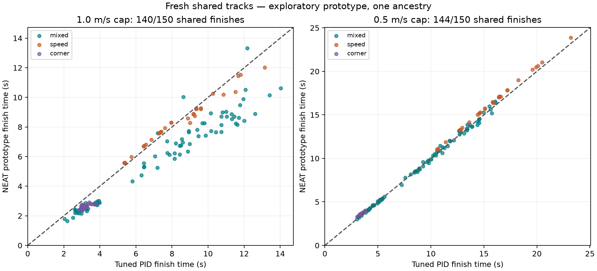

# Finalized NEAT and PID comparison

Exploratory fresh-test comparison of a validation-ineligible NEAT prototype, one ancestry; no official winner or five-seed confirmation.

Controllers were frozen before generating 150 fresh geometries (90 mixed, 30 speed, 30 corner). Each pair ran at the same cap and physics. There was no further training or test-based selection.

| Cap | Controller | Completion | Mean episode speed | Peak speed | Geometric RMSE | Jitter |
|---:|---|---:|---:|---:|---:|---:|
| 1.0 | neat | 148/150 | 0.709 m/s | 1.002 m/s | 19.61 mm | 0.009054 |
| 1.0 | pid | 141/150 | 0.602 m/s | 1.003 m/s | 29.81 mm | 0.001249 |
| 0.5 | neat | 145/150 | 0.397 m/s | 0.495 m/s | 5.24 mm | 0.005756 |
| 0.5 | pid | 148/150 | 0.406 m/s | 0.495 m/s | 8.70 mm | 0.001281 |

All-episode means include failed partial exposure. Paired successful-lap means below use only tracks both controllers finish.

| Cap | Shared finishes | NEAT / PID mean time |
|---:|---:|---:|
| 1.0 | 140/150 | 5.729 / 6.710 s |
| 0.5 | 144/150 | 9.473 / 9.305 s |



The NEAT prototype was joint-study g49 rank1. It completed 60/60 primary and 20/20 retention validation episodes, sustained at least 0.950181 m/s and passed straight yaw/steering/time checks, but failed the original geometric-RMSE and command-jitter protection gates. No official winner is claimed. Fresh test results do not retroactively remove those failures.

PID tuning evaluated 16,080 episodes. The 1.0 and 0.5 m/s tunes passed 60/60 selection tracks plus the previously consulted 45.77 m Rhythm Changes course. No eligible 1.5 m/s tune emerged; its best observed gains completed that course but only 29/60 selection tracks. That failed search is retained and excluded from this validated-baseline assessment.

This compares resulting controllers from one NEAT ancestry. Five-lineage confirmation and algorithm-wide superiority are unproven. No hardware robustness claim is made. All failures, speed/window measurements, paired error/jitter denominators and frozen model hashes are retained in report.json and the raw run.

Frozen controllers: `runs/neat-pid-finalization-20261125/frozen/`. Raw tracks/episodes: the same run folder. Earlier protocols and unsuccessful attempts remain in `docs/experiment-ledger.md`.

Reproduce the saved assessment/report (cached complete results are verified and reused):

```powershell
& .\.venv\Scripts\python.exe research/finalize_neat_pid.py --workers 6
```
