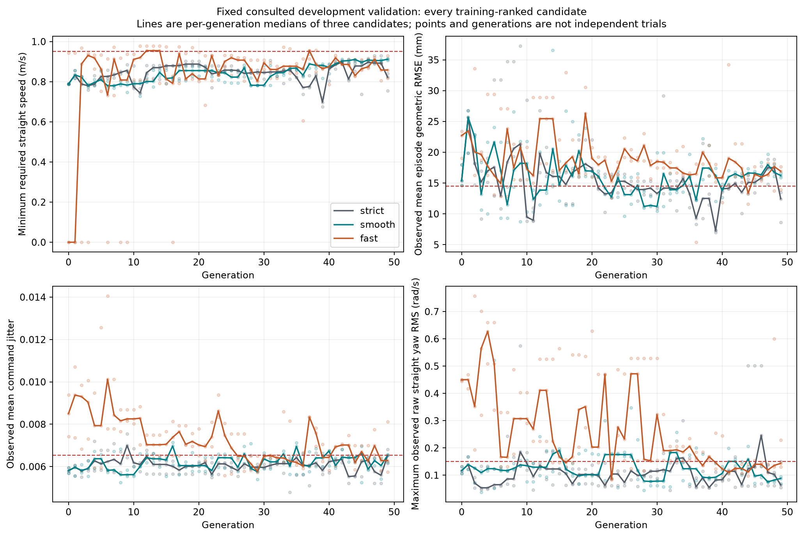
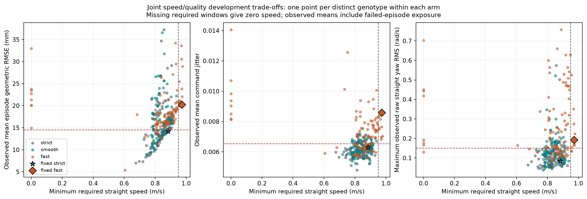

# Finished quality-speed follow-up — DEVELOPMENT

Both revised-fitness arms finished 50 generations with zero qualifying candidates. Strict V1 also had zero qualifiers. All 50 six-course batches and saved reference rows match byte-for-byte; consulted validation is the same 60 primary plus 20 retention courses. These results do not establish independent training repeatability or test generalization.

| Study | Candidate training episodes | Evaluated genomes | Unique validated genotypes / 150 records | New validation counters / known cached episodes used | New / reused reference episodes |
|---|---:|---:|---:|---:|---:|
| strict | 30,000 | 5,000 | 98 / 150 | 7,840 / 7,840 | 300 / 0 |
| smooth | 30,000 | 5,000 | 110 / 150 | 8,800 / 8,800 | 0 / 300 |
| fast | 30,036 | 5,006 | 104 / 150 | 8,320 / 8,320 | 0 / 300 |

Population sizes may fluctuate under stock NEAT; JSON records every generation size, all candidate decisions, rejection counts, repeats and training-quality tiers. Training tier names describe completion/quality status; the continuous reward differs from V1, so raw scalar fitness must not be compared as a common outcome. Cached episode counts exclude unknown partial work; candidates and generations are not independent replicates.

## Speed and quality together

The smooth arm's fastest speed-only nonqualifier was g34 rank 2: minimum required straight speed 0.866119 m/s, still below 0.95 m/s.
The fast arm's fastest speed-only nonqualifier was g44 rank 0: minimum required straight speed 0.830657 m/s, still below 0.95 m/s.

The fast arm produced 17 speed-passing candidate records representing 11 distinct genotypes, all rejected for other acceptance failures. They are not independent training repetitions. Fixed g33 rank 2 completed 60 primary and 20 retention courses and passed paired time, with 0.972635 m/s minimum straight speed, but mean episode geometric RMSE 20.251 mm, jitter 0.0085931, maximum raw yaw 0.19325 rad/s and steering 0.02130 exceed their original limits (14.493 mm, 0.0065299, 0.15 and 0.02). No official winner is promoted.





The error reference line is the full fast-parent mean; the actual acceptance gate uses each candidate’s shared successful tracks. Observed all-episode error includes partial exposure on failures. Read figures alongside completion/rejection data; median curves do not select a model.

## Fixed representatives versus the newly frozen retuned PID

PID config SHA-256: `d6df8d4275b568583dcaf652a131f7c3f17f4d6923998828eb1322562c78b5cc`. Exactly 60 new PID episodes were evaluated, using two workers and a source/protocol/suite/config freeze created before evaluation. Both NEAT representatives use existing saved caches. This is reused development validation, not a fresh shared test.

| Controller | Completion / 60 | Failures | Observed mean episode error | Observed mean jitter | Min required speed | Max raw yaw | Max steering |
|---|---:|---|---:|---:|---:|---:|---:|
| strict_g40 | 60 | none | 14.151 mm | 0.0062963 | 0.88419 m/s | 0.08372 rad/s | 0.01146 |
| fast_g33 | 60 | none | 20.251 mm | 0.0085931 | 0.97263 m/s | 0.19325 rad/s | 0.02130 |
| retuned_pid | 59 | {'off_route': 1} | 22.844 mm | 0.0011416 | 0.93618 m/s | 0.09506 rad/s | 0.01678 |

| NEAT / retuned PID | Shared successes / 60 | Mean time NEAT / PID | Mean episode error NEAT / PID | Mean jitter NEAT / PID |
|---|---:|---:|---:|---:|
| strict_g40_vs_retuned_pid | 59 | 6.140 / 6.893 s | 13.846 / 20.925 mm | 0.0062208 / 0.0011255 |
| fast_g33_vs_retuned_pid | 59 | 6.166 / 6.893 s | 19.776 / 20.925 mm | 0.0085150 / 0.0011255 |

All failures remain in JSON, including their full episode rows. Paired comparisons use identical shared-success course IDs and report the denominator; all-episode observed error/jitter means include failure exposure. Required-window minima include zero for missing windows; yaw/steering maxima use observed raw windows. Neither representative qualifies under every unchanged acceptance condition. An independent fresh shared test must follow the settled protocol and final PID/NEAT controller freeze.

Exact consumed bytes and both report helpers are preserved in hash-addressed snapshot `4a75dd3a0816fac1f1a654b947965c4de7a73ac6a4861bcbd9bac532922eefa3`. JSON records input/model/source hashes and all numeric evidence. Old strict-V1 g21/g40 reports remain unchanged.

Replay this report without physics:

```powershell
& .\.venv\Scripts\python.exe 'C:\Users\yazan\OneDrive\Desktop\Yazan Stuff\Coding Projects\NEAT Line Follower\results\neat-quality-followup-v1\snapshots\4a75dd3a0816fac1f1a654b947965c4de7a73ac6a4861bcbd9bac532922eefa3\report_quality_followup.py' --snapshot 'C:\Users\yazan\OneDrive\Desktop\Yazan Stuff\Coding Projects\NEAT Line Follower\results\neat-quality-followup-v1\snapshots\4a75dd3a0816fac1f1a654b947965c4de7a73ac6a4861bcbd9bac532922eefa3' --out 'C:\Users\yazan\OneDrive\Desktop\Yazan Stuff\Coding Projects\NEAT Line Follower\results\neat-quality-followup-v1'
```
