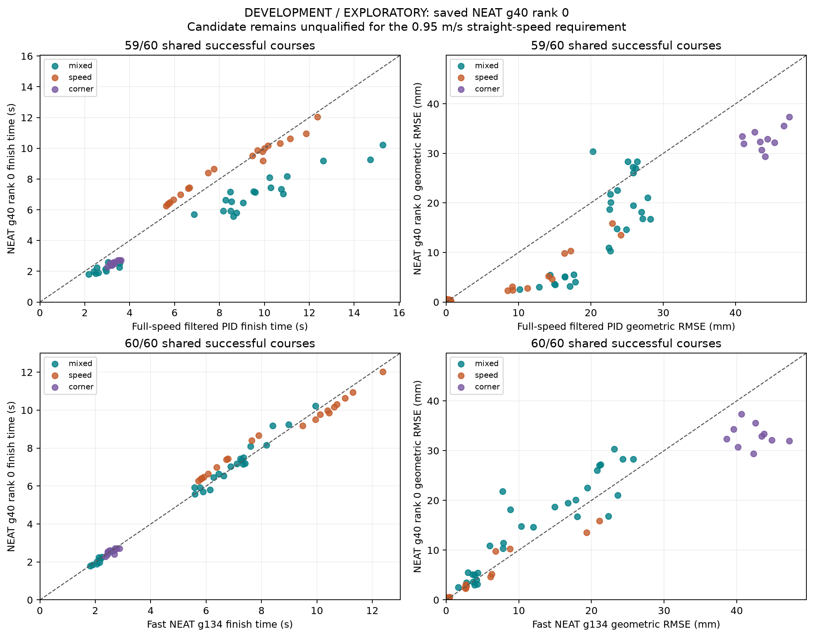

# DEVELOPMENT / EXPLORATORY: saved NEAT g40 rank 0 versus PID

This uses the same 60 saved primary development courses at a verified 1 m/s cap. The candidate is generation 40, rank 0, named by the consumed training report. It remains unqualified: its minimum required-straight speed is below 0.95 m/s. No official winner is promoted; these reused selection data are not a fresh test.

| Controller | Completion | Failures | Observed mean episode geometric RMSE | Observed mean command jitter |
|---|---:|---|---:|---:|
| NEAT g40 rank 0 | 60/60 | none | 14.151 mm | 0.0062963 |
| Full-speed filtered PID | 59/60 | {'off_route': 1} | 22.102 mm | 0.0011875 |
| Fast NEAT g134 | 60/60 | none | 14.493 mm | 0.0065299 |

Observed means include all 60 episodes, including partial exposure on failures. They do not replace the matched shared-success comparisons below.

| Left / right controller | Shared successful tracks | Mean finish time left / right | Mean episode geometric RMSE left / right | Mean jitter left / right |
|---|---:|---:|---:|---:|
| NEAT g40 rank 0 / Full-speed filtered PID | 59/60 | 6.054 / 7.123 s | 14.197 / 20.565 mm | 0.0062703 / 0.0011714 |
| Fast NEAT g134 / Full-speed filtered PID | 59/60 | 5.993 / 7.123 s | 14.605 / 20.565 mm | 0.0065187 / 0.0011714 |
| NEAT g40 rank 0 / Fast NEAT g134 | 60/60 | 6.078 / 6.016 s | 14.151 / 14.493 mm | 0.0062963 / 0.0065299 |

| Controller | Required / missing windows | Minimum required-window speed | Maximum raw yaw RMS | Maximum steering RMS |
|---|---:|---:|---:|---:|
| NEAT g40 rank 0 | 20 / 0 | 0.8842 m/s | 0.0837 rad/s | 0.01146 |
| Full-speed filtered PID | 20 / 0 | 0.9269 m/s | 0.0744 rad/s | 0.01576 |
| Fast NEAT g134 | 20 / 0 | 0.8298 m/s | 1.3956 rad/s | 0.16766 |

Missing windows contribute zero required-window speed; yaw/steering maxima describe observed windows. Acceptance limits are speed ≥0.95 m/s, raw yaw RMS ≤0.15 rad/s and steering RMS ≤0.02.



Each point is one shared successful course, colored by course group. Below the diagonal means a smaller candidate value. Failed courses remain in the all-episode summary and exact captured JSON, and are excluded from shared-success finish-time plots. Lower command jitter and lower geometric error measure different behavior; no blanket superiority claim follows.

Input snapshot: `b070af2d238cadb8b479532d5a59e65725341f38dff34127a5f7976ab303f99a`. Exact consumed report, episode caches, frozen model/parameter bytes, suite/protocol, manifest and reporting source are preserved under `snapshots/`. `report.json` records input/model/source hashes, failure rows and paired course identities. Existing snapshots are verified and never overwritten.

Replay from the project root with the recorded Python/dependencies (this reads the snapshot only):

```powershell
& .\.venv\Scripts\python.exe 'C:\Users\yazan\OneDrive\Desktop\Yazan Stuff\Coding Projects\NEAT Line Follower\results\neat-quality-speed-v1\candidate-g40-pid-development\snapshots\b070af2d238cadb8b479532d5a59e65725341f38dff34127a5f7976ab303f99a\report-source.py' --snapshot 'C:\Users\yazan\OneDrive\Desktop\Yazan Stuff\Coding Projects\NEAT Line Follower\results\neat-quality-speed-v1\candidate-g40-pid-development\snapshots\b070af2d238cadb8b479532d5a59e65725341f38dff34127a5f7976ab303f99a' --out 'C:\Users\yazan\OneDrive\Desktop\Yazan Stuff\Coding Projects\NEAT Line Follower\results\neat-quality-speed-v1\candidate-g40-pid-development'
```
