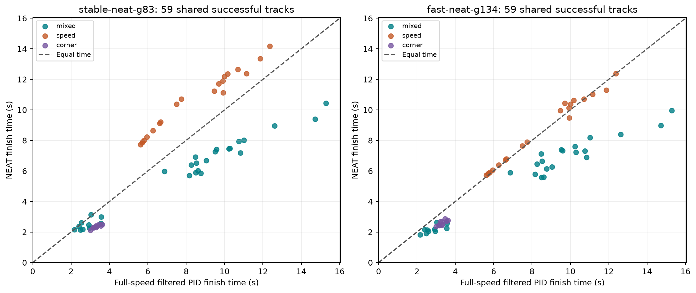

# Shared development baseline before quality-speed evolution

Controllers and inputs were frozen before evaluation. All three controllers use the same 1 m/s cap, physical sensors, simulation and 60 development courses. This is not fresh final-test evidence.

| Controller | Completion | Observed mean chassis speed | Observed geometric RMSE | Command jitter |
|---|---:|---:|---:|---:|
| stable-neat-g83 | 60/60 | 0.641 m/s | 7.35 mm | 0.006050 |
| fast-neat-g134 | 60/60 | 0.730 m/s | 14.49 mm | 0.006530 |
| pid-fullspeed-1m | 59/60 | 0.627 m/s | 22.10 mm | 0.001187 |

All-episode means include incomplete exposure and do not replace matched comparisons. PID completed 60/60 on its distinct tuning-validation suite, but failed one course off-route on this shared development suite. Both saved NEAT references completed 60/60 here.

## Shared-success comparison

| NEAT reference | Shared tracks | NEAT / PID mean time | NEAT / PID geometric RMSE | NEAT / PID jitter |
|---|---:|---:|---:|---:|
| stable-neat-g83 | 59 | 6.723 / 7.123 s | 7.35 / 20.57 mm | 0.005990 / 0.001171 |
| fast-neat-g134 | 59 | 5.993 / 7.123 s | 14.60 / 20.57 mm | 0.006519 / 0.001171 |

Points below the diagonal favor NEAT time on that course; points above favor PID. Failed PID courses are excluded from time comparison and retained in the completion count/raw JSON. Course groups expose why high straight speed alone does not determine whole-route finish time.

The stable g83 controller is slower than PID on long straights, yet its mean paired completion time is smaller on the whole development mix. PID has substantially lower overall command jitter. These results do not justify blanket superiority claims and must be checked with fresh final tracks after protocol development.

The 0.5 m/s auxiliary evaluation transfers the 1 m/s PID gains; it is not labeled a separately tuned low-speed baseline. Frozen model hashes and all raw episodes are under `runs/neat-quality-speed-v1/baseline-development/`. `shared-development-baseline.json` includes the failure row and matched error/jitter denominators.

Reproduce with `& .\.venv\Scripts\python.exe research/report_quality_development.py`. This reporting command starts no training or simulation.
