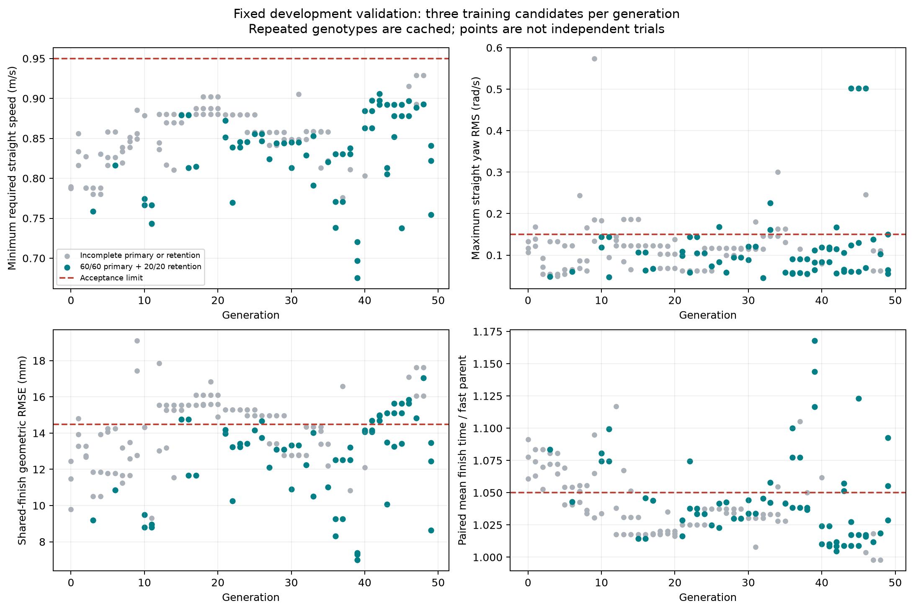
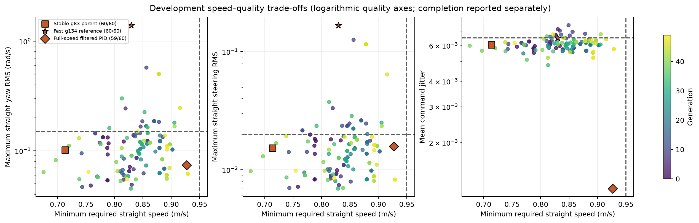
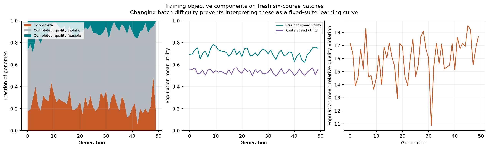

# Quality-speed development results

Status: completed. 50 logged generations, 30,000 candidate training episodes, 300 reference episodes and 7,840 completed cache-backed validation episodes for the reported candidates.

Generation counters record 7,840 new validation episodes. After interruption they can exclude previously cached complete evaluations; the cache-backed count retains that known work. Unknown partial evaluations and currently unlogged generation candidates are excluded from both reported budgets.

150 candidate records represent 98 distinct validated genotypes. Exact repeats reuse the frozen deterministic evaluation; generations/candidates are not independent repetitions.

0 candidate records passed every unchanged acceptance rule. An official best model exists only if a candidate qualifies.

The fastest candidate rejected only for straight speed is generation 40, rank 0: minimum required straight speed 0.8842 m/s, maximum straight yaw RMS 0.0837 rad/s, 60/60 primary and 20/20 retention completions. Paired time ratio to fast g134 is 1.0103; shared-finish geometric RMSE is 14.151 mm and mean command jitter 0.0062963. This is a documented trade-off, not a qualifying winner.







All three training-ranked candidates are shown, including failures. The geometric-error reference line is the full fast-parent mean; the actual gate uses each candidate’s shared successful tracks. Required-window speed includes zero for missing windows. The yaw/steering panels describe observed windows and must be read with missing-window and completion counts in the CSV.

The pilot starts from a previously selected g83 controller. Improvements here cannot establish independent training repeatability or generalization. Selection thresholds, training source, inputs and episode data remain frozen. Fresh shared testing follows controller freezing after protocol development.

Regenerate from the project root:

```powershell
& .\.venv\Scripts\python.exe research/report_quality_training.py
```

This command reads saved artifacts only. JSON records all numeric metrics, input hashes and the reporting-source hash. PNG and SVG versions of each figure are provided.
