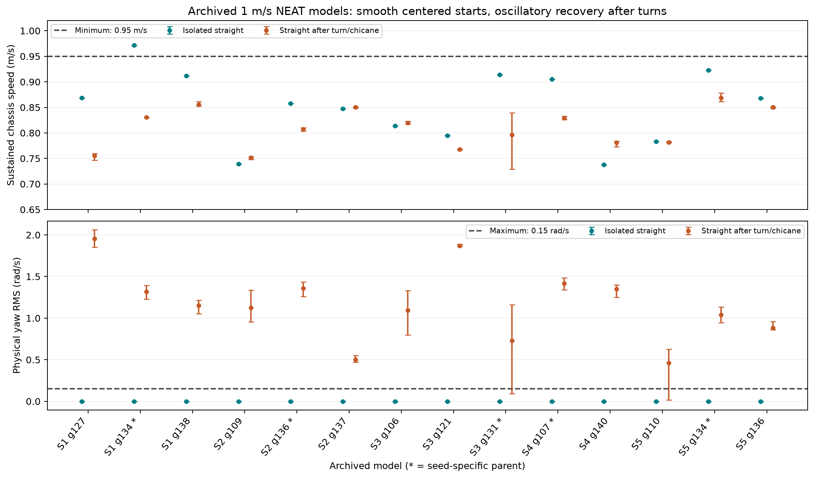

# Smooth-driving study: frozen inputs and archive audit

Snapshot: 24 November 2026. [Audit report](audit-report.md) · [Numerical summary](audit-summary.json) · [Protocol](protocol.json) · [SHA-256 manifest](manifest.json).

**No archived candidate passed every speed/smoothness gate.** Primary completion was 58–60/60 at 1 m/s; retention was 20/20 at 0.5 m/s for every candidate. The audit exposed physical oscillation on post-turn recovery straights despite smooth perfectly centered isolated starts. These are validation results, not final test results or evidence that a future pilot succeeded.



The points show means across ten windows per group, with minimum–maximum whiskers, not confidence intervals. Asterisks identify the five seed-specific parents.

## Frozen files

- `frozen-inputs/seed-01.pkl` through `seed-05.pkl`: original native-1 m/s parents at generations 134, 136, 131, 107 and 134. They are starting references, not newly trained winners.
- `frozen-inputs/audit-s*-g*.pkl`: exact archived candidates used in this audit.
- `frozen-inputs/pid-fullspeed-100.json`: validated base-1.0 filtered PID reference. The `pid-legacy-*.json` files remain historical restricted-cruise inputs and are not the new full-speed baselines.
- `frozen-inputs/geometry-freeze.json` and `showcase-track.json`: frozen robot geometry record and exploratory long course.
- `audit-episodes/`: all 14 candidate evaluations at the primary and retention caps, including failure reasons and per-window physical metrics.
- `parent-references/`: the corresponding five parent evaluations on the same courses.
- `protocol.json`, preparation summary and implementation checks: exact protocol provenance and delivery checks. The protocol retains original local source paths as historical provenance; those paths are not download links.

Copies preserve their original bytes. `manifest.json` records hashes and byte sizes; the original live run remains unchanged. Saved genomes use the project's trusted pickle artifact format and NEAT-Python 0.92; load models with the matching source/dependencies.

## Running and restoring

The compact `prepared-bundle.zip` contains the complete frozen prepared execution tree, completed audit, audit review and parent references. Its SHA-256 and restoration scope are recorded in `prepared-bundle-manifest.json`. It excludes any live training stage or generation checkpoint.

On a **fresh checkout** with matching dependencies installed and no existing smooth-study run, restore its original relative paths, then verify:

```powershell
Expand-Archive -LiteralPath results/neat-smooth-study-v1/prepared-bundle.zip -DestinationPath .
& .\.venv\Scripts\python.exe run_neat_smooth_study.py verify
```

Follow [the methodology and manual stage commands](../../docs/neat-smooth-study.md). Do not extract over an active or existing run. Preparing from scratch also requires the historical run inputs described there; restoring the bundle allows verification and manual pilot execution without re-preparation. The initial Git publication does not include all historical raw runs, checkpoint state or videos. Keep separate backups and publish a matching bulk data archive with the paper.
