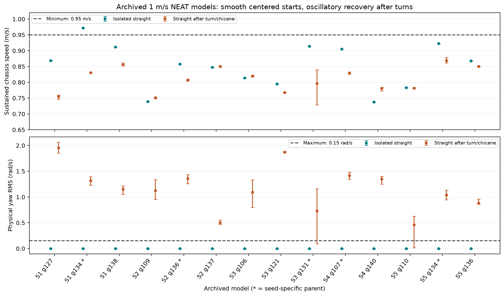

# Archived NEAT speed and smoothness audit — 24 November 2026

**Complete: 0 of 14 archived candidates passed every predeclared gate.**

This audit evaluated 14 historical native-1 m/s champions and five seed-specific parent references. Each controller used 60 primary validation episodes at a 1 m/s cap and 20 retention episodes at 0.5 m/s: 1,520 evaluated episodes including references. These are validation data used for selection, not fresh final-test results.

## Findings

- All 14 candidates completed 58–60/60 primary tracks and 20/20 retention tracks.
- Every candidate failed the required per-window straight speed, physical yaw and steering gates somewhere. No required straight window was missing.
- All perfectly centered isolated straights had effectively zero yaw and steering oscillation. Every candidate exceeded the yaw and steering thresholds on at least some post-turn recovery straights. This identifies a recovery-related weakness in these conditions; it does not establish behavior under arbitrary perturbations.
- Seed 1 generation 134 sustained 0.972 m/s on isolated straights but only 0.830 m/s after turns. Its mean recovery yaw RMS was 1.319 rad/s versus the 0.150 limit. Small tracking error alone therefore does not establish smooth physical motion.
- The other four frozen parents averaged only 0.857–0.923 m/s even on isolated straights. The issue is both achieved speed and post-turn smoothness.
- Across the 14 candidates, additional rejection reasons were paired lap time (5 models), increased command jitter (3), fewer mixed-track completions (2), and increased shared-finish geometric RMSE (1). Reason counts overlap.

## Five frozen starting parents

| Seed / generation | Primary completed | Retention completed | Isolated speed (m/s) | Post-turn speed (m/s) | Post-turn yaw RMS (rad/s) |
|---|---:|---:|---:|---:|---:|
| 1 / 134 | 60/60 | 20/20 | 0.972 | 0.830 | 1.319 |
| 2 / 136 | 60/60 | 20/20 | 0.858 | 0.808 | 1.358 |
| 3 / 131 | 58/60 | 20/20 | 0.914 | 0.796 | 0.732 |
| 4 / 107 | 60/60 | 20/20 | 0.905 | 0.829 | 1.416 |
| 5 / 134 | 59/60 | 20/20 | 0.923 | 0.869 | 1.039 |

Each speed/yaw cell averages ten central-2-m windows. Acceptance applies to every window, not these means. The limits at the primary cap are speed ≥0.95 m/s, yaw RMS ≤0.15 rad/s, and normalized steering RMS ≤0.02.



Points show means and whiskers show the minimum–maximum across ten windows per group. They are not confidence intervals. All windows were observed.

## All candidate results

| Seed / generation | Primary | Retention | Paired time ratio | Shared finishes | Shared-finish RMSE (mm) | Rejection reasons |
|---|---:|---:|---:|---:|---:|---|
| 1 / 127 | 60/60 | 20/20 | 1.0541 | 60 | 11.58 | command_jitter, paired_time, straight_speed, straight_steering, straight_yaw |
| 1 / 134 | 60/60 | 20/20 | 1.0000 | 60 | 14.49 | straight_speed, straight_steering, straight_yaw |
| 1 / 138 | 60/60 | 20/20 | 1.0124 | 60 | 15.19 | geometry_lateral_rmse_m, straight_speed, straight_steering, straight_yaw |
| 2 / 109 | 59/60 | 20/20 | 1.0513 | 59 | 8.93 | paired_time, primary_mixed_completion, straight_speed, straight_steering, straight_yaw |
| 2 / 136 | 60/60 | 20/20 | 1.0000 | 60 | 14.93 | straight_speed, straight_steering, straight_yaw |
| 2 / 137 | 59/60 | 20/20 | 0.9778 | 59 | 12.69 | primary_mixed_completion, straight_speed, straight_steering, straight_yaw |
| 3 / 106 | 58/60 | 20/20 | 1.0336 | 58 | 11.77 | straight_speed, straight_steering, straight_yaw |
| 3 / 121 | 59/60 | 20/20 | 1.0559 | 58 | 10.35 | paired_time, straight_speed, straight_steering, straight_yaw |
| 3 / 131 | 58/60 | 20/20 | 1.0000 | 58 | 13.12 | straight_speed, straight_steering, straight_yaw |
| 4 / 107 | 60/60 | 20/20 | 1.0000 | 60 | 13.19 | straight_speed, straight_steering, straight_yaw |
| 4 / 140 | 60/60 | 20/20 | 1.0615 | 60 | 9.64 | command_jitter, paired_time, straight_speed, straight_steering, straight_yaw |
| 5 / 110 | 60/60 | 20/20 | 1.0593 | 59 | 9.13 | command_jitter, paired_time, straight_speed, straight_steering, straight_yaw |
| 5 / 134 | 59/60 | 20/20 | 1.0000 | 59 | 14.46 | straight_speed, straight_steering, straight_yaw |
| 5 / 136 | 60/60 | 20/20 | 1.0128 | 59 | 12.95 | straight_speed, straight_steering, straight_yaw |

Paired time is the ratio of mean completion times on tracks both candidate and corresponding parent finish. A ratio above 1.05 fails. Parent comparisons with themselves have ratio 1 by construction. RMSE uses that same candidate-specific shared-success set, so the denominators can differ.

## Next step

No existing model satisfies the requested combined target. Run the old-fitness continuation pilot and smooth-fitness pilot separately, then review the saved validation trade-offs. This audit does not demonstrate that either future pilot will succeed. PID tuning remains a separate stage; no PID was compared in this audit.

```powershell
& .\.venv\Scripts\python.exe run_neat_smooth_study.py pilot --branch old --workers 2
& .\.venv\Scripts\python.exe run_neat_smooth_study.py pilot --branch smooth --workers 2
& .\.venv\Scripts\python.exe run_neat_smooth_study.py review-pilot
```

Run one branch at a time. This report only reads saved results; it starts no evolution, tuning or new simulations. Reproduce it with `& .\.venv\Scripts\python.exe runs/neat-smooth-study-v1/audit-review/report.py`. The frozen source and protocol were verified before summarizing. `summary.json` preserves input hashes and the full numerical breakdown.
