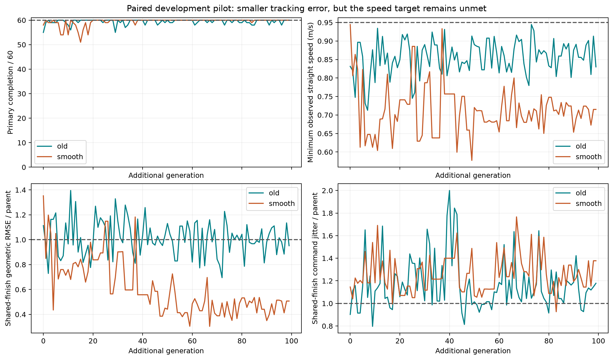
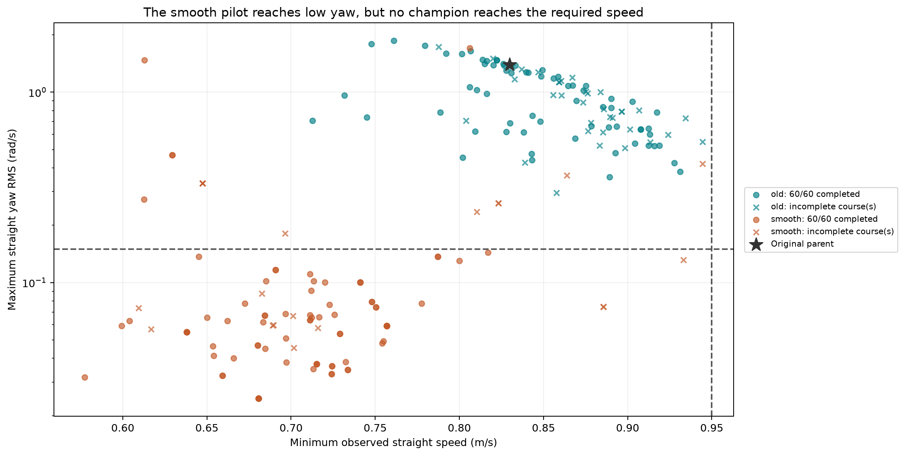
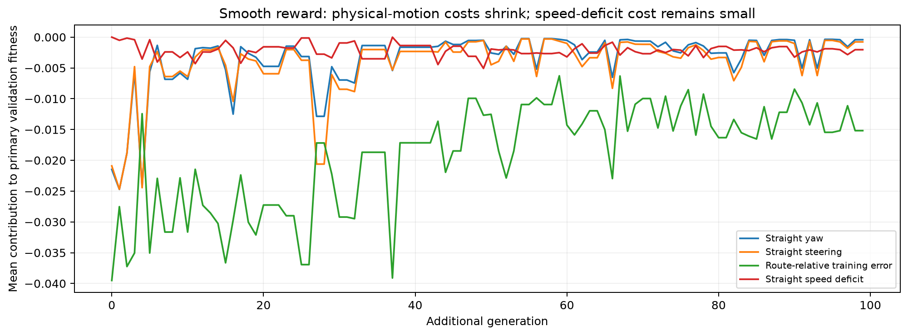

# Completed seed-1 old versus smooth reward pilot

**Both 100-generation branches completed. Neither produced a champion meeting all predeclared criteria. Five-lineage confirmation is blocked.**

The frozen review verified identical parents, initial evolution seed, references and all 100 six-track generation batches. Target population and generation budgets matched. Actual training episodes differed slightly because stock NEAT population sizes can fluctuate.

| Outcome | Old fitness | Smooth fitness |
|---|---:|---:|
| Training episodes | 60,000 | 60,012 |
| Validation episodes | 8,000 | 8,000 |
| Champions completing 60/60 primary tracks | 65/100 | 80/100 |
| Champions passing straight yaw + steering gates | 0/100 | 84/100 |
| Fully qualifying champions | 0 | 0 |
| Logged generation wall time | 4.85 h | 1.75 h |

All 200 champions completed all 20 low-speed retention courses. Wall times exclude unlogged startup/repeated interrupted work. The old run used two workers; smooth used four, then six, then eight, so these wall times do not isolate fitness-related compute efficiency.

## A useful trade-off example: smooth generation 83

| Metric | Original parent | Smooth g83 |
|---|---:|---:|
| Primary completion | 60/60 | 60/60 |
| Isolated straight speed | 0.972 m/s | 0.713 m/s |
| Post-turn straight speed | 0.830 m/s | 0.713 m/s |
| Post-turn mean yaw RMS | 1.319 rad/s | 0.057 rad/s |
| Shared-finish geometric RMSE | 14.49 mm | 7.35 mm |
| Whole-course command jitter | 0.006530 | 0.006050 |

Generation 83 also retained 20/20 low-speed completions and passed every primary yaw and steering window. Its only rejection reasons were straight speed and paired time: laps were 12.07% slower, exceeding the 5% allowance. It is an exploratory example chosen after reviewing the rejection list, not an official best model or a held-out test result.

The final smooth champion (g99) also completed 60/60 and 20/20, with 7.35 mm geometric RMSE and about 0.715 m/s sustained speed. Post-turn yaw averaged 0.016 rad/s. Whole-course jitter was 0.008996 (about 38% above the parent), and paired laps were 12.45% slower. The final generation is not the best observed trade-off.

## What the reward is doing

The smooth reward produced many controllers passing the physical straight-motion requirements in this single development lineage. Speed remains the limiting requirement: every champion in both branches failed at least one required speed window.

At 0.715 m/s, the additional speed-deficit penalty is approximately -0.0061 on an eligible straight course. The bounded yaw and steering terms can together approach -0.30. The original completion-speed bonus remains in the fitness. These magnitudes suggest that the new weighting can accept substantial speed loss in exchange for physical smoothness; they do not prove a unique cause or global optimum.

Rescoring the same stored parent validation episodes under the smooth formula gives mean score 2.273506, versus the final smooth champion's 2.294574. Under the old formula, the corresponding scores are 2.352758 and 2.312988. Thus the new formula rewards this slower final controller more highly on these validation episodes even though it fails the combined acceptance target. This is a diagnostic rescore of saved episodes, not additional physics or a breeding-fitness comparison: reproduction uses the six-course mean/CVaR aggregation.

## Figures



Curves show all 100 champions per branch. Shared-finish error/jitter ratios use each candidate-specific matched parent subset. Raw repeated validation is selection evidence, not independent test repetitions.



Points summarize minimum observed speed and maximum raw yaw across required windows. A missing window separately fails acceptance and is not treated as success. The old run has one such missing-window champion. Steering gates and time/error/jitter remain independent checks; occupying a favorable speed/yaw region alone would not establish qualification.



Components are mean primary-validation contributions. Tracking cost uses route-relative RMSE, not the independent geometric RMSE used in acceptance. The old branch has no added smoothness costs by definition; zero omitted costs would not mean zero oscillation.

## Frozen illustrative models and next step

The `frozen/` directory contains exact copies of the original parent, old g99, smooth g83 and smooth g99, with a SHA-256 manifest. None is relabeled as a qualifying study winner. Original checkpoint, logs and all 100 champions per branch remain in the live run archive.

Do not launch the five confirmation lineages under this unsuccessful pilot, relax gates after seeing the outcome, or present g83 as meeting the 1 m/s goal. A separately versioned follow-up should address the speed/smoothness balance and be compared against these preserved controls. Additional generations alone have not been shown to solve it.

This comparison is one development lineage with shared validation courses. It supports descriptive conclusions about these runs, not a general superiority claim for NEAT, an algorithm-wide causal effect of reward shaping, or hardware performance. No final test tracks were opened and no new evolution was started during review.

Reproduce after both branches finish:

```powershell
& .\.venv\Scripts\python.exe run_neat_smooth_study.py review-pilot
& .\.venv\Scripts\python.exe research/compare_smooth_pilots.py
```

`summary.json` contains all champion metrics, reward components and source hashes. `champions.csv` is the flat comparison table. All figures are supplied as PNG and SVG. These new reports/models are local until explicitly committed and pushed.
