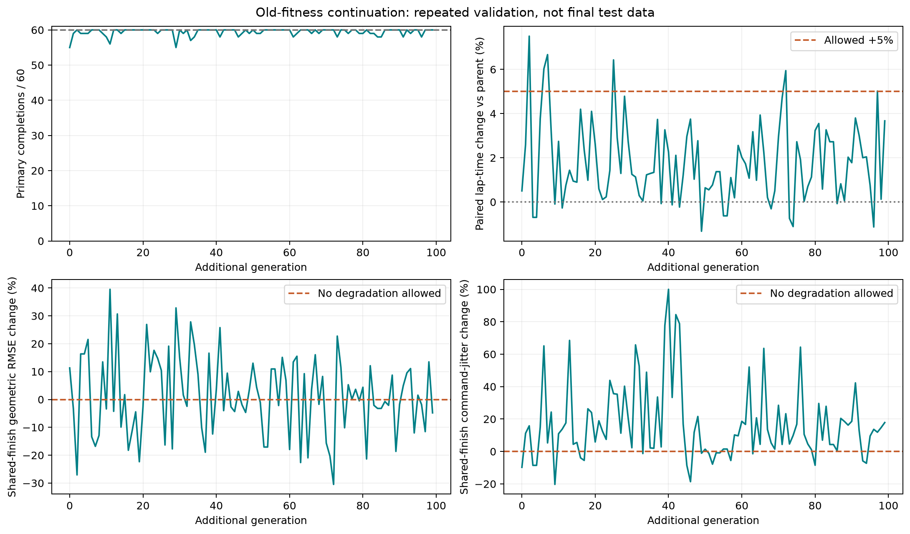
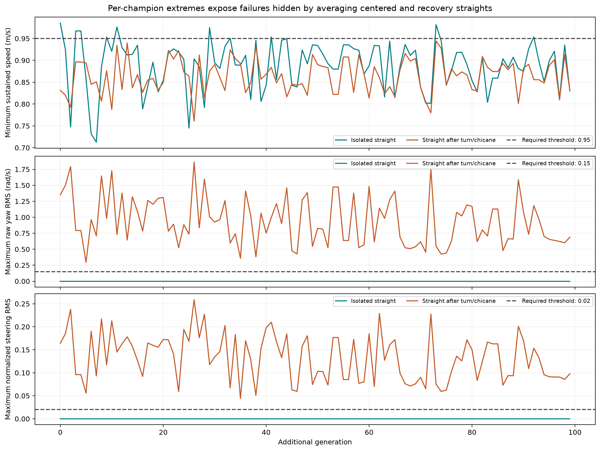

# Seed-1 old-fitness pilot: 100-generation review

**Completed cleanly; no champion passed all predeclared gates.**

Budget: 60,000 training episodes and 8,000 validation episodes. Logged generation wall time: 4.85 hours; this excludes unlogged startup/overhead. Latest committed population generation: 100, corresponding to completed generation 99.

This is the old-reward control using the new six-course profile, two workers, a target population of 100, and a fixed 1 m/s cap. These repeated validation courses select candidates; they are not untouched test evidence.

## Parent versus final-generation champion

| Metric | Original seed-1 g134 parent | Additional generation 99 |
|---|---:|---:|
| Primary completion | 60/60 | 60/60 |
| Isolated-straight mean speed | 0.972 m/s | 0.830 m/s |
| Post-turn straight mean speed | 0.830 m/s | 0.839 m/s |
| Post-turn straight mean yaw RMS | 1.319 rad/s | 0.385 rad/s |
| Geometric RMSE, shared finishes | 14.49 mm | 13.80 mm |
| Command jitter, all primary episodes | 0.006530 | 0.007695 |

The final champion took 3.67% longer on the 60 shared successful tracks, within the 5% allowance. Its improved average recovery yaw and geometric error do not establish acceptance: sustained speed, maximum per-window yaw/steering, and command jitter still fail. The final generation is an illustrative endpoint, not an officially selected best model.

## Across the whole run

- 65/100 champions completed all 60 primary tracks. Every champion retained 20/20 low-speed completions.
- Every champion failed at least one speed, yaw and steering window. One champion also had an unobserved required straight.
- Generation 5 had the lowest mean yaw across all 20 windows, 0.0976 rad/s. Half the windows are perfectly centered isolated straights with effectively zero yaw. Its post-turn mean was 0.1953 and maximum 0.2959 rad/s, so a combined mean below 0.15 did not pass the per-window yaw rule. It also completed 59/60 and degraded error/jitter.
- Generation 72 had the smallest shared-finish geometric RMSE (10.08 mm), but post-turn yaw averaged 1.698 rad/s, isolated speed was 0.802 m/s, and paired laps were 5.94% slower. Small geometric error alone did not ensure fast, smooth motion.
- Both neural outputs were evaluated in every champion. This confirms evaluator execution status, not the cause of any remaining control behavior.

Rejection counts overlap: geometry_lateral_rmse_m: 51, primary_corner_completion: 11, primary_mixed_completion: 28, primary_speed_completion: 1, straight_speed: 100, straight_steering: 100, straight_yaw: 100, unfinished_straight: 1, command_jitter: 81, paired_time: 6.



Paired time/error/jitter use the candidate-specific shared-success tracks and matched parent values. Completion keeps all 60 trials. Curves show individual champions with no smoothing or confidence intervals.



Each series shows the minimum speed or maximum yaw/steering among observed windows in that course group. Missing windows independently fail acceptance and remain recorded in raw results; they are not successful zero-motion measurements.

## Interpretation and next step

For this one seed and 100-generation budget, continued old-reward training on the new courses did not meet the combined target. Evolution found different speed/error/smoothness trade-offs. This does not establish that more generations can never help, that NEAT cannot solve the task, or that the proposed new reward will succeed.

Next run the separately prepared smooth-fitness pilot, then review both completed branches under the same criteria. Do not extend this control or weaken its thresholds after observing its results.

```powershell
& .\.venv\Scripts\python.exe run_neat_smooth_study.py pilot --branch smooth --workers 2
& .\.venv\Scripts\python.exe run_neat_smooth_study.py review-pilot
```

The second command requires both branches to finish; no confirmation or assessment is started by generating this report. Reproduce with:

```powershell
& .\.venv\Scripts\python.exe research/summarize_smooth_pilot.py --branch old
```

All 100 champions remain under the original run `pilot/seed-01/old/champions/`. No qualifying `best.pkl` was manufactured. `summary.json` records all champion metrics and source hashes; `champions.csv` provides a flat table. Figures are supplied as PNG and SVG.
